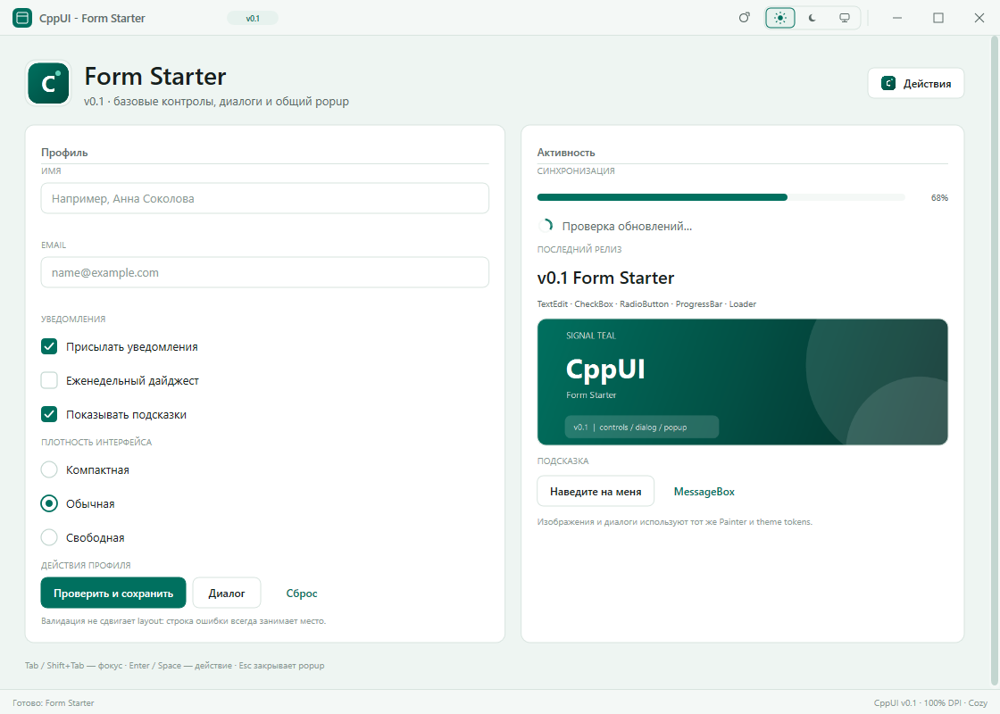

# CppUI

**CppUI** — рабочее название лёгкого UI-фреймворка для Windows на C++20. Цель — быстрый и предсказуемый десктопный toolkit с кастомным окном, аппаратной отрисовкой, аккуратными темами и API, которое не заставляет писать инфраструктуру заново в каждом приложении.

> Статус: **v0.1 Form Starter реализован** (см. [docs/V01.md](docs/V01.md)); M0 принят с environment-waivers.
> Дата: 15.11.2026.

## Ключевые решения

- **Windows-first**: Windows 11 x64 в приоритете, Windows 10 — best effort. Cross-platform не входит в первый этап.
- **C++20**, MSVC 2022/2026, CMake, статическая библиотека. Ninja — основной путь для CI; Visual Studio generator используется локально на локализованной MSVC.
- **Win32 + DWM** для окна и кастомного title bar; **D3D11 + DXGI flip-model + Direct2D/DirectWrite** для отрисовки.
- **Retained-mode** дерево виджетов с layout-проходами `measure → arrange → paint`, без HTML/CSS-движка.
- **Ноль сторонних runtime-зависимостей**: только Windows SDK. Тесты — собственные исполняемые файлы и CTest; внешний test framework не подключён.
- **Визуальное направление Signal Teal** (выбрано после аудита `design_chats`), светлая/тёмная/системная тема через семантические дизайн-токены.
- **Density S / M / L** и паттерны data-workspace с inline editing и row states зафиксированы в дизайне.
- **Управляемая область**: сначала фундамент и форма, затем контролы волнами. Полный список контролов не входит в первый релиз.

## Документация

| Документ | Назначение |
|---|---|
| [PLAN.md](PLAN.md) | Основной план создания, цели, границы, этапы и риски |
| [docs/PHASE0.md](docs/PHASE0.md) | Bootstrap: CMake, токены, первое окно |
| [docs/PHASE1.md](docs/PHASE1.md) | Platform + render: device loss, WARP, idle CPU, smoke test |
| [docs/PHASE2.md](docs/PHASE2.md) | Custom chrome: title bar, hit testing, maximize/restore, DWM |
| [docs/PHASE3.md](docs/PHASE3.md) | Retained-mode core, Button, UiHost, Light/Dark/System |
| [docs/PHASE4.md](docs/PHASE4.md) | Form preview, StatusBar, titlebar actions |
| [docs/PHASE5.md](docs/PHASE5.md) | DPI matrix, benchmark, CI, hardening results |
| [docs/M0.md](docs/M0.md) | M0 sign-off, доказательства и environment-waivers |
| [docs/V01.md](docs/V01.md) | v0.1 Form Starter: объём, демо, тесты, ограничения |
| [docs/CONTROLS.md](docs/CONTROLS.md) | Публичный API каждого контрола v0.1 |
| [docs/RISKS.md](docs/RISKS.md) | Реестр рисков и автоматические gates |
| [CONTROL_BACKLOG.md](CONTROL_BACKLOG.md) | Полный каталог контролов, недостающие элементы, зависимости и волны |
| [docs/ROADMAP.md](docs/ROADMAP.md) | Релизы, ориентировочные сроки, критерии выхода |
| [docs/ARCHITECTURE.md](docs/ARCHITECTURE.md) | Архитектура, стек, окно, рендер, API и структура проекта |
| [docs/DESIGN_SYSTEM.md](docs/DESIGN_SYSTEM.md) | Визуальный язык, токены, спецификация формы и кнопок |
| [docs/DESIGN_REFERENCES.md](docs/DESIGN_REFERENCES.md) | Аудит `design_chats`: какие дизайны, палитры и паттерны стоит взять |
| [docs/QUALITY.md](docs/QUALITY.md) | Тестовая стратегия, DPI-матрица, performance-бюджеты и release checklist |
| [docs/RISKS.md](docs/RISKS.md) | Реестр рисков, триггеры, владельцы и gate-проверки |
| [docs/DECISIONS.md](docs/DECISIONS.md) | Журнал принятых и открытых решений |
| [design/README.md](design/README.md) | Описание макетов, галереи контролов и скриншотов |

## v0.1 Form Starter



Экран собран на публичном `Form`: `TextEdit`, `CheckBox`, `RadioGroup`, `ProgressBar`,
`Loader`, `PictureBox`, `PopupMenu`, `Dialog`/`MessageBox` и `ToolTip`. Работают Light/Dark/System,
density S/M/L, hover/pressed/focus, Tab/Shift+Tab, undo/redo, clipboard, IME result string,
валидация без сдвига layout и модальные окна с возвратом фокуса.

Тёмная тема: [v01-form-dark.png](docs/images/v01-form-dark.png). Компактный режим:
[v01-form-compact.png](docs/images/v01-form-compact.png). Popup:
[v01-form-popup.png](docs/images/v01-form-popup.png). MessageBox:
[v01-messagebox.png](docs/images/v01-messagebox.png). API — [docs/CONTROLS.md](docs/CONTROLS.md).

## Hardening (Phase 5)

- CTest **14/14** после v0.1: theme, UI, v0.1 controls, Form, Dialog, DPI awareness, render smoke,
  DPI matrix, mixed-DPI, chrome, benchmark gate, visual regression для M0 и Form Starter,
  плюс отдельный WARP-прогон визуальных эталонов.
- Simulated DPI matrix **96 / 120 / 150 / 200** с Light/Dark и S/M/L.
- Реальная mixed-DPI проверка на двух мониторах: **120 DPI / 96 DPI**.
- Snap Layouts, Alt+Space и Alt+F4 проверены; screenshots в [docs/M0.md](docs/M0.md).
- Visual snapshots Light/Dark/Compact в `tests/baselines`, сравнение через WIC/D2D; для v0.1 добавлены Form Starter и popup.
- Публичный `Form` API с Create/SetContent/theme/density/status/Show/Run/CapturePng.
- v0.1: `ScrollViewer`, `TextEdit`, `CheckBox`, `RadioGroup`, `ProgressBar`, `Loader`, `PopupHost`, `Dialog`, `MessageBox`, `Image`, `Command`.
- Release benchmark после v0.1: **120 FPS** (VSync), **~1.7 ms CPU/кадр**, layout **~0.18 ms**, startup **97 ms**.
- M0 idle CPU **≈0%**; private memory **43.8 MB** (hard 60 MB), working set 64.4 MB включает shared GPU.
- Clean build-каталог Debug собран с нуля; после v0.1 — **14/14** тестов.

M0 принят с waivers: 150/200% DPI simulated, clean-machine и remote CI недоступны в текущем окружении. `Form` API — [include/cppui/form.hpp](include/cppui/form.hpp). Подробности M0 — в [docs/PHASE5.md](docs/PHASE5.md), v0.1 — в [docs/V01.md](docs/V01.md).

## Визуальный концепт

- [**Галерея контролов**](design/controls-gallery.html) — пять экранов, Light / Dark, density S/M/L и inline editing.
- [Обзор галереи, Light](design/controls-overview-light.png) · [Dark](design/controls-overview-dark.png)
- [Рабочее место, Light](design/controls-workspace-light.png) · [Dark](design/controls-workspace-dark.png) · [inline editing](design/controls-workspace-edit.png)
- [Интерактивный макет формы](design/form-preview.html) — Light / Dark / System.
- [Форма, светлая тема](design/form-light.png) · [тёмная тема](design/form-dark.png)


## Текущее состояние

- [x] Зафиксированы цели, технический стек и границы первого этапа.
- [x] Собран визуальный концепт формы в двух темах.
- [x] Собрана галерея всех запланированных контролов в двух темах.
- [x] Выбрано направление **Signal Teal**, добавлены density S/M/L и data-workspace с inline editing.
- [x] Проведён аудит `design_chats` и зафиксированы дизайн-референсы.
- [x] Составлен каталог планируемых контролов и зависимостей.
- [x] Разложены релизы и критерии качества.
- [x] Найден и проверен toolchain (VS 2026 / MSVC 19.51, Windows SDK 10.0.26100, CMake 4.3, Ninja 1.13).
- [x] Инициализирован git-репозиторий и CMake-каркас.
- [x] Появился первый исполняемый пример: окно с D3D11/DXGI/Direct2D.
- [x] Добавлены smoke-тест, Debug/Release пресеты и CI workflow.
- [x] Выделен `Win32Window`, добавлены DPI/resize callbacks и WARP.
- [x] Добавлены device-loss recovery и render smoke test; idle CPU ≈ 0%.
- [x] Добавлен кастомный chrome: title bar, системные кнопки, hit testing, maximize/restore.
- [x] Добавлены retained-mode `Widget`, `StackPanel`, `CardPanel`, `Label`, `Button`.
- [x] Добавлены Light/Dark/System, переключатель темы в шапке и интерактивное demo.
- [x] Добавлен `DensityMode` Compact/Cozy/Comfortable для компактных Button.
- [x] Добавлены Form-preview, `FormPanel`, `StatusBar` и действие сброса в titlebar.
- [x] Добавлены DPI matrix 96–200, benchmark, visual regression и GitHub Actions workflow.
- [x] Добавлен публичный top-level `Form` API и integration test.
- [x] Проверен реальный переход между двумя мониторами 120 DPI / 96 DPI.
- [x] Snap Layouts, Alt+Space и Alt+F4 проверены.
- [x] M0 принят с environment-waivers: [docs/M0.md](docs/M0.md).
- [x] v0.1 Form Starter: поля, панели, scroll, popup, dialog, validation, image, tooltips.
- [x] 14/14 CTest, visual baselines Light/Dark/Compact/Popup и WARP, модальные Dialog/MessageBox.
- [x] Документация API всех контролов: [docs/CONTROLS.md](docs/CONTROLS.md).

## Сборка

Требования:

- Windows 11 x64 (Windows 10 — best effort).
- Visual Studio 2022/2026 с workload «Desktop development with C++» и Windows SDK.
- CMake 3.28+; Ninja — для CI/английской локали MSVC.
- Git.

Быстрый старт:

```powershell
.\tools\build.ps1 -Test
.\out\build\windows-vs2026-debug\Debug\cppui-bootstrap.exe
```

Скрипт находит Visual Studio, CMake и Ninja через `vswhere` и собирает нужный preset. Для VS 2022 используйте `-Preset windows-vs2022-debug`. Для Ninja-сборки на английской локали — `-Preset windows-msvc-debug`; подробнее в [docs/PHASE1.md](docs/PHASE1.md).

Проверки renderer:

```powershell
.\out\build\windows-vs2026-debug\Debug\cppui-bootstrap.exe --self-test
$env:CPPUI_FORCE_WARP = '1'
.\out\build\windows-vs2026-debug\Debug\cppui-bootstrap.exe --self-test
```

Benchmark (Release):

```powershell
Push-Location .\out\build\windows-vs2026-release
.\Release\cppui-bootstrap.exe --benchmark
Get-Content cppui-benchmark.txt
Pop-Location
```

`--self-test` проходит четыре комбинации DPI/density/theme; `--benchmark`
пишет frame/layout/resize/theme/density-метрики в `cppui-benchmark.txt`, а CTest
`cppui.benchmark` проверяет Release-пороги. `--capture-visual` пишет Light/Dark/Compact
PNG; Form Starter дополнительно снимает popup. CTest `cppui.visual` и
`cppui.visual_v01` и `cppui.visual_v01_warp` сравнивают их с `tests/baselines/`;
при расхождении сохраняется `diff-*.png`. В живом окне `F5`
принудительно пересоздаёт render device; Esc закрывает popup, а окно — Alt+F4.
Кастомный chrome проверяется вручную: min/max/close, resize и drag title bar.

## Ближайший шаг

v0.2 Input & Selection: `MemoEdit`, `ComboBox`, `CheckedComboBox`, `ListBox`, `ListView`,
`SpinEdit`, `DropDownButton`, `SplitButton`, `ToggleSwitch`, `Slider`, `DateEdit`/`Calendar`,
`TabControl`, `SplitContainer`, file/folder dialogs и начало UIA.

## Лицензия

Пока не выбрана. Это одно из открытых решений в [docs/DECISIONS.md](docs/DECISIONS.md). До определения лицензии не стоит делать репозиторий публичным.
