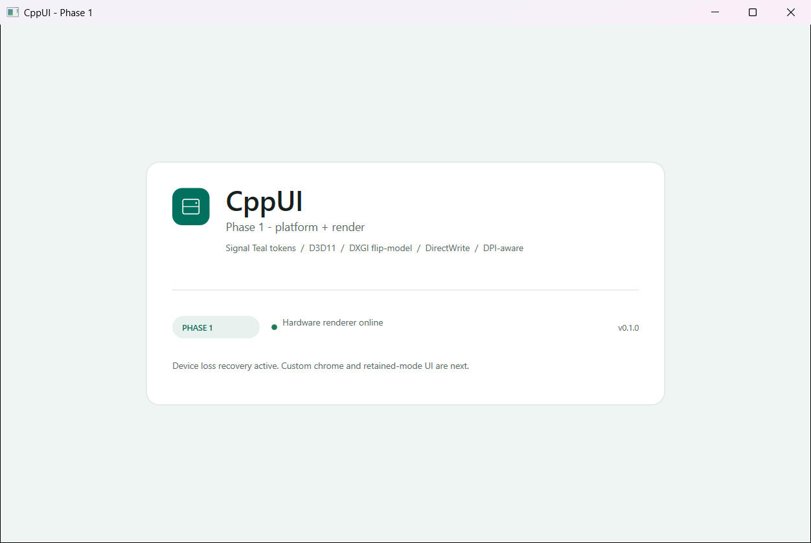
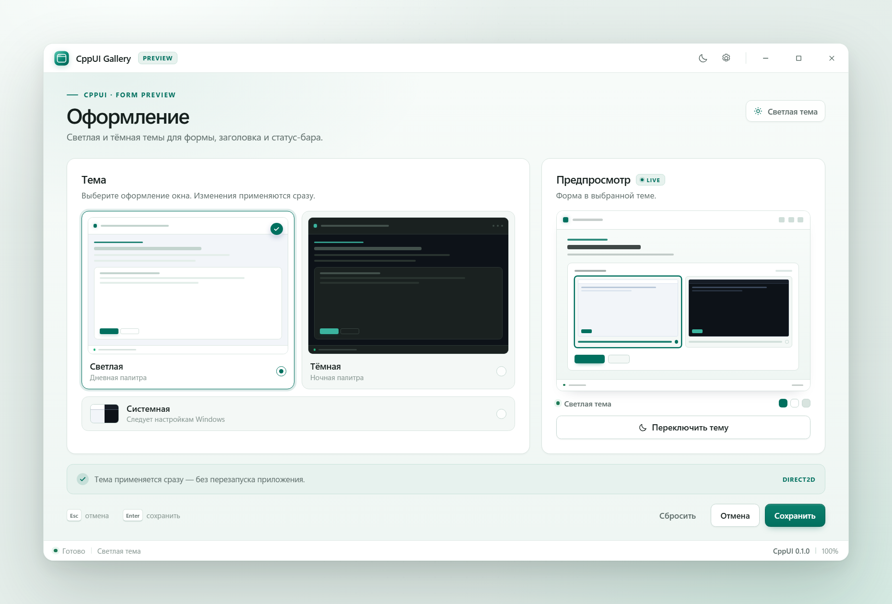

# CppUI

**CppUI** — рабочее название лёгкого UI-фреймворка для Windows на C++20. Цель — быстрый и предсказуемый десктопный toolkit с кастомным окном, аппаратной отрисовкой, аккуратными темами и API, которое не заставляет писать инфраструктуру заново в каждом приложении.

> Статус: **Phase 1 завершена**. Есть Win32 window layer, D3D11/DXGI/Direct2D renderer с WARP, device-loss recovery и smoke-тестами. Retained-mode ядро ещё впереди.
> Дата: 14.11.2026.

## Ключевые решения

- **Windows-first**: Windows 11 x64 в приоритете, Windows 10 — best effort. Cross-platform не входит в первый этап.
- **C++20**, MSVC 2022/2026, CMake, статическая библиотека. Ninja — основной путь для CI; Visual Studio generator используется локально на локализованной MSVC.
- **Win32 + DWM** для окна и кастомного title bar; **D3D11 + DXGI flip-model + Direct2D/DirectWrite** для отрисовки.
- **Retained-mode** дерево виджетов с layout-проходами `measure → arrange → paint`, без HTML/CSS-движка.
- **Ноль сторонних runtime-зависимостей**: только Windows SDK. Catch2 используется только в тестах.
- **Визуальное направление Signal Teal** (выбрано после аудита `design_chats`), светлая/тёмная/системная тема через семантические дизайн-токены.
- **Density S / M / L** и паттерны data-workspace с inline editing и row states зафиксированы в дизайне.
- **Управляемая область**: сначала фундамент и форма, затем контролы волнами. Полный список контролов не входит в первый релиз.

## Документация

| Документ | Назначение |
|---|---|
| [PLAN.md](PLAN.md) | Основной план создания, цели, границы, этапы и риски |
| [docs/PHASE0.md](docs/PHASE0.md) | Bootstrap: CMake, токены, первое окно |
| [docs/PHASE1.md](docs/PHASE1.md) | Platform + render: device loss, WARP, idle CPU, smoke test |
| [CONTROL_BACKLOG.md](CONTROL_BACKLOG.md) | Полный каталог контролов, недостающие элементы, зависимости и волны |
| [docs/ROADMAP.md](docs/ROADMAP.md) | Релизы, ориентировочные сроки, критерии выхода |
| [docs/ARCHITECTURE.md](docs/ARCHITECTURE.md) | Архитектура, стек, окно, рендер, API и структура проекта |
| [docs/DESIGN_SYSTEM.md](docs/DESIGN_SYSTEM.md) | Визуальный язык, токены, спецификация формы и кнопок |
| [docs/DESIGN_REFERENCES.md](docs/DESIGN_REFERENCES.md) | Аудит `design_chats`: какие дизайны, палитры и паттерны стоит взять |
| [docs/QUALITY.md](docs/QUALITY.md) | Тестовая стратегия, DPI-матрица, performance-бюджеты и release checklist |
| [docs/DECISIONS.md](docs/DECISIONS.md) | Журнал принятых и открытых решений |
| [design/README.md](design/README.md) | Описание макетов, галереи контролов и скриншотов |

## Phase 1: platform + render



Это реальный `cppui-bootstrap.exe`: Win32-окно, D3D11, DXGI flip-model, Direct2D/DirectWrite, hardware/WARP backend и восстановление после потери устройства. Сейчас используется стандартная рамка Windows; кастомный chrome и retained-mode UI — Phase 2+. Подробности, тесты и ограничения — в [docs/PHASE1.md](docs/PHASE1.md).

## Визуальный концепт

- [**Галерея контролов**](design/controls-gallery.html) — пять экранов, Light / Dark, density S/M/L и inline editing.
- [Обзор галереи, Light](design/controls-overview-light.png) · [Dark](design/controls-overview-dark.png)
- [Рабочее место, Light](design/controls-workspace-light.png) · [Dark](design/controls-workspace-dark.png) · [inline editing](design/controls-workspace-edit.png)
- [Интерактивный макет формы](design/form-preview.html) — Light / Dark / System.
- [Форма, светлая тема](design/form-light.png) · [тёмная тема](design/form-dark.png)




## Текущее состояние

- [x] Зафиксированы цели, технический стек и границы первого этапа.
- [x] Собран визуальный концепт формы в двух темах.
- [x] Собрана галерея всех запланированных контролов в двух темах.
- [x] Выбрано направление **Signal Teal**, добавлены density S/M/L и data-workspace с inline editing.
- [x] Проведён аудит `design_chats` и зафиксированы дизайн-референсы.
- [x] Составлен каталог планируемых контролов и зависимостей.
- [x] Разложены релизы и критерии качества.
- [x] Найден и проверен toolchain (VS 2026 / MSVC 19.51, Windows SDK 10.0.26100, CMake 4.3, Ninja 1.13).
- [x] Инициализирован git-репозиторий и CMake-каркас.
- [x] Появился первый исполняемый пример: окно с D3D11/DXGI/Direct2D.
- [x] Добавлены smoke-тест, Debug/Release пресеты и CI workflow.
- [x] Выделен `Win32Window`, добавлены DPI/resize callbacks и WARP.
- [x] Добавлены device-loss recovery и render smoke test; idle CPU ≈ 0%.
- [ ] Появился retained-mode `Form` с кнопкой и переключением темы.

## Сборка

Требования:

- Windows 11 x64 (Windows 10 — best effort).
- Visual Studio 2022/2026 с workload «Desktop development with C++» и Windows SDK.
- CMake 3.28+; Ninja — для CI/английской локали MSVC.
- Git.

Быстрый старт:

```powershell
.\tools\build.ps1 -Test
.\out\build\windows-vs2026-debug\Debug\cppui-bootstrap.exe
```

Скрипт находит Visual Studio, CMake и Ninja через `vswhere` и собирает нужный preset. Для VS 2022 используйте `-Preset windows-vs2022-debug`. Для Ninja-сборки на английской локали — `-Preset windows-msvc-debug`; подробнее в [docs/PHASE1.md](docs/PHASE1.md).

Проверки Phase 1:

```powershell
.\out\build\windows-vs2026-debug\Debug\cppui-bootstrap.exe --self-test
$env:CPPUI_FORCE_WARP = '1'
.\out\build\windows-vs2026-debug\Debug\cppui-bootstrap.exe --self-test
```

В живом окне `F5` принудительно пересоздаёт render device.

## Ближайший шаг

Phase 2: кастомный chrome (`WM_NCCALCSIZE`, `WM_NCHITTEST`, drag, системные кнопки, Snap Layouts, DWM corners), затем retained-mode ядро с `Form`, `Button` и темами.

## Лицензия

Пока не выбрана. Это одно из открытых решений в [docs/DECISIONS.md](docs/DECISIONS.md). До определения лицензии не стоит делать репозиторий публичным.
