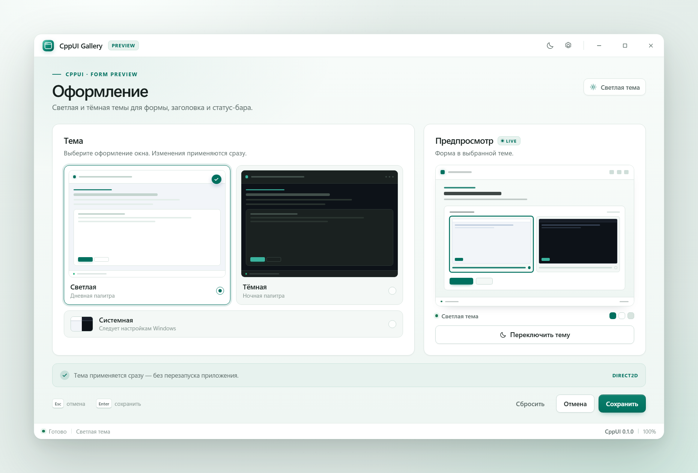
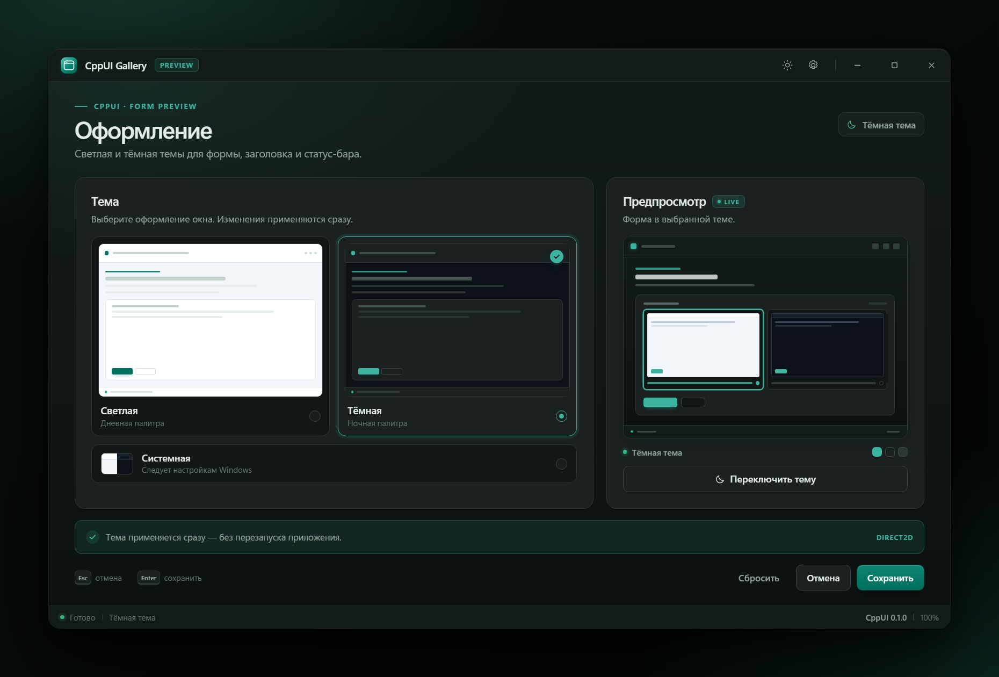

# DESIGN_SYSTEM — визуальный язык CppUI

> Статус: Draft · 14.11.2026.
> Связанные документы: [PLAN.md](../PLAN.md), [ARCHITECTURE.md](ARCHITECTURE.md), [CONTROL_BACKLOG.md](../CONTROL_BACKLOG.md), [DESIGN_REFERENCES.md](DESIGN_REFERENCES.md), [design/README.md](../design/README.md).

## 1. Визуальное направление

CppUI должен выглядеть как аккуратный современный desktop-toolkit, а не как веб-лендинг:

- спокойные нейтральные поверхности с лёгким зелёным подтоном;
- один **Signal Teal** акцент;
- мягкие границы и умеренные радиусы;
- читаемая типографика без декоративности;
- глубокая, но не чёрная тёмная тема;
- отсутствие тяжёлых теней, glassmorphism и градиентного шума в рабочих контролах.

Signal Teal выбран по итогам аудита [design_chats](DESIGN_REFERENCES.md); это не копия чужого интерфейса, а собственные токены CppUI на основе понравившегося направления.

Фон вокруг окна на скриншотах — **презентационная подложка**. В реальном приложении его заменяет рабочий стол; фреймворк рисует только окно, его chrome и контент.

## 2. Концепт формы

### Light



### Dark



- [Интерактивный макет формы](../design/form-preview.html) — Light / Dark / System и hover-состояния.
- Тёмную версию можно открыть сразу: `design/form-preview.html#dark`.
- [**Галерея всех контролов**](../design/controls-gallery.html) — пять экранов, Light / Dark, density и inline editing.
- [Обзор всех экранов, Light](../design/controls-overview-light.png) · [Dark](../design/controls-overview-dark.png).
- [Рабочее место и inline editing, Light](../design/controls-workspace-edit.png) · [Dark](../design/controls-workspace-edit-dark.png).
- [Описание макетов и их границ](../design/README.md).

## 3. Композиция формы

```text
┌──────────────────────────────────────────────────────┐
│ TitleBar: [logo] [title] [badge]     [actions] [– □ ×]│  40 DIP
├──────────────────────────────────────────────────────┤
│                                                      │
│ ContentHost                                          │  flex
│   └─ Panel / GridPanel / StackPanel / контролы       │
│                                                      │
├──────────────────────────────────────────────────────┤
│ StatusBar: [● Готово]                  [версия] [%]  │  28 DIP
└──────────────────────────────────────────────────────┘
```

Базовые размеры:

| Параметр | Значение |
|---|---|
| Окно в макете | 1120 × 720 DIP |
| Радиус окна | 14 DIP (DWM на Win11) |
| Title bar | 40 DIP |
| Status bar | 28 DIP |
| Системная кнопка | 46 × 40 DIP; кликабельная область на всю высоту title bar |
| Доп. действие title bar | 30 × 28 DIP; hit target расширять до ≥ 32 × 32 DIP |
| App mark | 22 × 22 DIP |
| Контент | padding 26–32 DIP |
| Карточка | radius 12 DIP, border 1 DIP |
| Кнопка | height 32–34 DIP, radius 7–8 DIP |

Минимальный размер формы для демо — 720 × 480 DIP; окончательное значение уточняется на layout-тестах.

## 4. Дизайн-токены

Токены семантические: контролы не используют «сырые» hex-значения напрямую, только роли.

### 4.1 Светлая тема

| Токен | Значение | Роль |
|---|---|---|
| `bg.window` | `#EEF5F2` | Фон окна |
| `bg.titlebar` | `#FFFFFF` | Title bar |
| `bg.content` | gradient `#F7FBF9 → #EEF5F2` | Контент |
| `surface.default` | `#FFFFFF` | Карточки, поля, поверхности |
| `surface.soft` | `#F4F8F6` | Вторичные поверхности |
| `surface.hover` | `#E8F2EF` | Hover-фон |
| `border.default` | `#D8E4DF` | Обычные границы |
| `border.strong` | `#C3D6D0` | Активные/контурные границы |
| `text.primary` | `#16201E` | Заголовки, основной текст |
| `text.secondary` | `#5C6B68` | Описания |
| `text.tertiary` | `#8A9994` | Метаданные |
| `accent.default` | `#00705F` | Акцент, ссылки, иконки |
| `accent.soft` | `#E7F2EE` | Мягкая заливка |
| `accent.border` | `#C8E2DA` | Граница акцентной плашки |
| `button.primary` | `#00705F` | Основная кнопка |
| `button.primaryTop` | `#0C806D` | Верх градиента |
| `button.primaryText` | `#FFFFFF` | Текст primary |
| `success.default` | `#1E7A57` | Готовность |
| `warning.default` | `#B77900` | Предупреждение |
| `warning.soft` | `#FFF6E5` | Фон предупреждения |
| `danger.default` | `#D9483B` | Ошибки |
| `caption.closeHover` | `#C42B1C` | Hover close |
| `focus.ring` | `rgba(0,112,95,0.22)` | Фокус-кольцо |

### 4.2 Тёмная тема

| Токен | Значение | Роль |
|---|---|---|
| `bg.window` | `#0C1211` | Фон окна |
| `bg.titlebar` | `#131B19` | Title bar |
| `bg.content` | gradient `#121A18 → #0C1211` | Контент |
| `surface.default` | `#1A2120` | Карточки, поля |
| `surface.soft` | `#121716` | Вторичные поверхности |
| `surface.hover` | `#22302D` | Hover-фон |
| `border.default` | `#2C3735` | Обычные границы |
| `border.strong` | `#3B4A46` | Контурные границы |
| `text.primary` | `#E4ECEA` | Основной текст |
| `text.secondary` | `#93A4A0` | Описания |
| `text.tertiary` | `#687873` | Метаданные |
| `accent.default` | `#3BB39E` | Акцент, ссылки, иконки |
| `accent.soft` | `rgba(59,179,158,0.12)` | Мягкая заливка |
| `accent.border` | `rgba(59,179,158,0.28)` | Граница акцентной плашки |
| `button.primary` | `#006E5C` | Основная кнопка |
| `button.primaryTop` | `#0E8773` | Верх градиента |
| `button.primaryText` | `#FFFFFF` | Текст primary |
| `success.default` | `#34B37E` | Готовность |
| `warning.default` | `#FDB022` | Предупреждение |
| `warning.soft` | `rgba(253,176,34,0.10)` | Фон предупреждения |
| `danger.default` | `#FF6B6B` | Ошибки |
| `caption.closeHover` | `#C42B1C` | Hover close |
| `focus.ring` | `rgba(59,179,158,0.25)` | Фокус-кольцо |

Важно: в тёмной теме `accent` (`#3BB39E`) и `button.primary` (`#006E5C`) — разные роли. Светлый акцент используется для иконок и checkbox; заливка primary-кнопки должна быть темнее, чтобы белый текст имел нормальный контраст. Текст на accent-заливках (checkmark, radio dot) в тёмной теме — тёмный (`--on-accent`).

### 4.3 Системная тема

- `ThemeMode::System` следует теме Windows.
- Изменение системной темы применяется без перезапуска.
- Приложение может принудительно выбрать Light или Dark.
- Системный accent color пока не используем автоматически; это открытое решение.

## 5. Типографика

| Роль | Размер | Вес | Использование |
|---|---:|---:|---|
| Display / H1 | 29–30 DIP | 600 | Заголовок страницы |
| H2 / Section | 15 DIP | 600 | Заголовки карточек |
| Body | 13 DIP | 400 | Основной текст |
| Body small | 11–12 DIP | 400 | Описания |
| Label / Button | 12–13 DIP | 600 | Кнопки, подписи |
| Caption / Meta | 10–10.5 DIP | 400–500 | Статус-бар, метаданные |
| Badge | 8.5–9 DIP | 700 | `PREVIEW`, `LIVE` |

Шрифт:

```text
Segoe UI Variable Text / Display
  → fallback: Segoe UI
  → fallback: system-ui
```

Системный шрифт не бандлится. В текущем окружении Segoe UI Variable может отсутствовать; макет корректно работает на Segoe UI. Для типографической иерархии использовать не более двух-трёх весов.

## 6. Отступы и радиусы

Шкала отступов: **4 / 8 / 12 / 16 / 24 / 32 DIP**.

Радиусы:

- 4 — бейджи, маленькие чипы;
- 6–7 — кнопки, input-поля, системные действия;
- 8–10 — карточки и группы;
- 12 — крупные surface-карточки;
- 14 — окно.

Границы — 1 DIP, выравнивать по пиксельной сетке. Не смешивать тяжёлые тени с большими радиусами без необходимости.

## 7. Title bar

Слева:

- app mark 22 × 22;
- название 12.5 DIP semibold;
- опциональный бейдж состояния (`Preview`, `Beta`).

Справа:

- дополнительные действия (тема, настройки, команды приложения);
- вертикальный разделитель;
- стандартные minimize / maximize-restore / close.

Состояния:

- обычное;
- hover на действии — мягкая заливка `surface.hover`;
- pressed — темнее;
- close hover — красный `caption.closeHover`, белая иконка;
- неактивное окно — приглушённые иконки и заголовок.

Правила:

- пустая область заголовка — drag/double-click;
- максимизация/восстановление — стандартная иконка;
- maximize должен поддерживать Windows 11 Snap Layouts;
- дополнительные кнопки имеют tooltip и accessible name;
- текст заголовка обрезается ellipsis;
- title bar не является обычным `Button`-контейнером — это часть `Form`.

## 8. Status bar

- Высота 28 DIP, верхняя граница 1 DIP.
- Слева: индикатор состояния (точка/иконка) + короткий статус.
- Справа: версия, DPI, координаты или другой контекст.
- Текст 10 DIP, вторичный цвет.
- Не использовать статус-бар для важных ошибок, которые требуют действия; для этого есть `InfoBar`/диалоги.

## 9. Кнопки

Базовые варианты:

| Вариант | Фон | Текст | Граница | Применение |
|---|---|---|---|---|
| Primary | акцентная заливка | белый | темнее фона | Главное действие |
| Secondary | surface | primary text | border.strong | Альтернативное действие |
| Ghost | прозрачный | secondary text | нет | Малоакцентное действие |
| Danger | danger | белый | темнее | Деструктивное действие (позже) |

Высота 32–34 DIP, padding 12–16 DIP, radius 7–8 DIP. Для icon-only использовать квадрат 32 × 32.

Состояния:

- normal;
- hover (120 ms);
- pressed (80 ms);
- focus-visible — ring 2–3 DIP с отступом;
- disabled — сниженный контраст, без hover;
- loading — только после появления асинхронных команд (позже).

`DropDownButton`/`SplitButton` — отдельные поведения, не «кнопка с ещё одной кнопкой внутри». Они используют общий `PopupMenu`.

## 10. Иконки

- Собственные векторные SVG/path-иконки, штрих 1.25–1.5 DIP, скруглённые концы.
- Не использовать системный icon font как обязательную зависимость: версии шрифтов различаются.
- Иконки должны быть читаемы в 16 и 20 DIP.
- Иконка без текста обязана иметь tooltip и accessible name.
- Для app mark допустим небольшой градиент; для рабочих иконок — одноцветный `currentColor`.

## 11. Motion

| Действие | Длительность | Кривая |
|---|---:|---|
| Hover кнопки/действия | 120 ms | ease-out |
| Press | 80 ms | ease-out |
| Смена темы | 180 ms | ease-out |
| Появление popup | 100–140 ms | ease-out |
| Закрытие popup | 80–100 ms | ease-in |

Правила:

- уважать `prefers-reduced-motion`;
- не анимировать layout без необходимости;
- не блокировать ввод анимацией;
- тема может переключаться без плавного перехода, если пользователь отключил анимации.

## 12. Доступность

- Контраст основного текста — не ниже 4.5:1.
- Фокус визуально заметен и не удаляется.
- Все действия доступны с клавиатуры.
- Цвет не является единственным носителем состояния.
- Иконки-кнопки имеют accessible name.
- Высота кликабельной области — не менее 32 DIP; для titlebar actions расширять hit target.
- Проверить Light/Dark, 100–200% DPI и (позже) High Contrast.
- UIA-поддержка вводится поэтапно; визуальная доступность не заменяет её.

## 13. Галерея контролов

Для визуальной проверки собран отдельный интерактивный макет на пять экранов:

- [controls-gallery.html](../design/controls-gallery.html) — Light / Dark, навигация, density S/M/L и inline editing.
- [Обзор Light](../design/controls-overview-light.png) · [Обзор Dark](../design/controls-overview-dark.png).
- Полноразмерные PNG и таблица покрытия — в [design/README.md](../design/README.md).

| Экран | Что показывает |
|---|---|
| 01 · Ввод и действия | Button (icon/dropdown/split/focus/disabled), Label/LinkLabel, TextEdit/Search/Password/Spin/Masked/Memo, CheckBox, RadioButton, ToggleSwitch, Slider, ProgressBar, Loader, Validation, InfoBar, Image |
| 02 · Выбор и списки | ComboBox, CheckedComboBox, DateEdit + Calendar, ListBox, CheckedListBox, ListView |
| 03 · Данные | TreeList, GridView, PropertyGrid, VerticalGrid |
| 04 · Рабочее место | TreeList + GridView + PropertyGrid в одном workspace, toolbar, bottom dock, inline editing и row states |
| 05 · Макет и оверлеи | TabControl, GroupPanel/Panel, SplitContainer, PopupMenu, ToolTip, Dialog/MessageBox, BusyOverlay |

Оболочка галереи одновременно показывает `Form`, `MenuBar`, `ToolBar`/`BarManager` и `StatusBar`.

Что важно для реализации:

- волны отмечены на карточках: `M0`, `v0.1`, `v0.2`, `v0.3`;
- галерея — концепт, а не доказательство готовности всех контролов;
- `VerticalGrid` помечен как открытое решение;
- цвета, отступы и радиусы должны перейти в токены, а не остаться в статичном HTML.

### 13.1 Density

Density — свойство theme-слоя, а не отдельного контрола. В gallery оно применено к data workspace и переключается кнопками S / M / L.

| Режим | Строка | Контрол | Шрифт | Применение |
|---|---:|---:|---:|---|
| Compact | 25 DIP | 25 DIP | 9.5 DIP | плотные инженерные таблицы |
| Cozy | 30 DIP | 28 DIP | 10.5 DIP | default |
| Comfortable | 36 DIP | 32 DIP | 11.5 DIP | настройки, редкие действия |

В C++ это должно стать `DensityMode`, влияющим на row/control height, paddings, font size и gap. Сейчас в HTML продемонстрирован workspace-вариант; глобальное применение ко всем контролам — задача реализации.

### 13.2 Inline editing и row states

Экран «Рабочее место» показывает:

- inline-редактор в ячейке статуса: раскрывается по клику, занимает всю ячейку и не сдвигает колонки;
- row state `Running` с прогрессом;
- `Failed` с фоном ошибки и левым маркером;
- `new` и `changed` маркеры;
- selection строки и связанный inspector;
- bottom dock с проблемами и изменениями;
- density-переключатель.

Вне текущей галереи остаются опциональные контролы поздних волн: `ColorPicker`, `Accordion`/`Expander`, `NavigationView`/`Breadcrumb`, `Toast`, `Skeleton`, `Docking`, `CodeEditor`. Они перечислены в [CONTROL_BACKLOG.md](../CONTROL_BACKLOG.md), но их визуальный дизайн ещё не утверждён. `Badge` и `InfoBar` показаны как простые стили поверхности и не считаются отдельными реализованными контролами.

High Contrast, полноценные hover/pressed/disabled-состояния inline-редакторов и расширенная accessibility-матрица требуют отдельных итераций.

## 14. Открытые вопросы

1. Финальный бренд и app icon.
2. Оставляем ли фиксированный Signal Teal или добавляем настройку accent color.
3. Нужны ли Mica/acrylic и когда.
4. Оставаться ли на Segoe UI или добавить IBM Plex/Golos как опциональный font-профиль.
5. Когда делать DensityMode глобальным для всех контролов.
6. Нужен ли `RadioCard` как отдельный контрол или только стиль.
7. Когда включать High Contrast.
