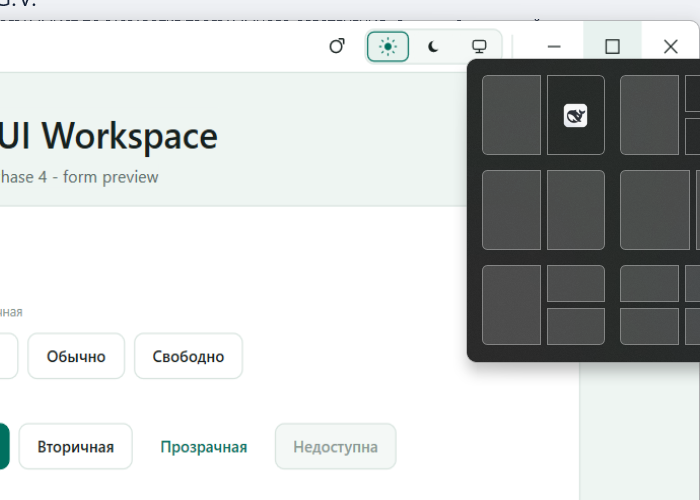
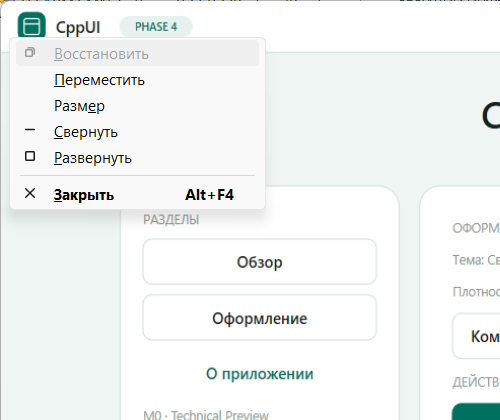

# M0 Technical Preview — sign-off

> Статус: **M0 принят с документированными environment-waivers** · 14.11.2026.
> Связанные документы: [PHASE5.md](PHASE5.md), [QUALITY.md](QUALITY.md), [ROADMAP.md](ROADMAP.md), [PLAN.md](../PLAN.md).

## Итог

M0 проверен на Windows 11 x64 с двумя мониторами **120 DPI и 96 DPI**.
Все локально воспроизводимые критерии Technical Preview пройдены; три
пункта, требующие другого окружения, приняты с waiver и не блокируют v0.1.

## Доказательства

Snap Layouts при hover на maximize:

Alt+Space открывает системное меню, включая Alt+F4:

## Матрица

| Критерий | Результат |
|---|---|
| Demo собирается по инструкции | **PASS**: clean build directory Debug/Release |
| Custom chrome hit testing | **PASS**: caption/min/max/close/resize/client |
| Minimize / restore / maximize | **PASS** |
| Mixed-DPI два монитора | **PASS**: 120 DPI и 96 DPI |
| 150 / 200% DPI | **SIMULATED PASS**: 150 и 200 в renderer matrix; real monitors unavailable |
| Snap Layouts | **PASS** визуально |
| Alt+Space | **PASS** визуально |
| Alt+F4 | **PASS** |
| Тема без перезапуска | **PASS** |
| Tab/Shift+Tab, Space/Enter, focus | **PASS** |
| Unit/integration/visual tests | **PASS**: 8/8 Debug и Release |
| CI | **LOCAL PASS**: workflow повторяет Debug/Release/CTest; remote runner waived |
| Idle CPU | **PASS**: 0.000 ms / 8 s |
| Resize | **PASS**: 8 размеров, DwmFlush worst 17.7 ms |
| Performance | **PASS hard**: CPU ~1.8 ms, layout ~0.15 ms |
| Startup | **PASS in-app**: 101 ms до первого кадра |
| Memory | **PASS hard**: 43.8 MB private; 64.4 MB working set включает shared driver |
| Clean machine | **WAIVED**: fresh build directory; отдельная машина недоступна |

## Waivers

1. **150/200% real DPI.** На машине только 120/96. 150/200 проверены в
   offscreen renderer matrix с target-size invariant; Snap/mixed-DPI проверены
   на реальных мониторах 120/96.
2. **Clean machine.** Полный clean build directory Debug/Release пройден;
   отдельная чистая Windows-машина в текущем окружении недоступна.
3. **Remote CI.** Workflow `.github/workflows/windows.yml` добавлен и повторяет
   локальный прогон; удалённый runner не настроен, поэтому CI помечен waived,
   а не зелёным.
4. **Input-to-photon / flicker.** Flicker специально не измерялся
   высокоскоростной камерой; resize stress и DwmFlush не показали зависаний
   или пустых кадров. Input-to-photon остаётся метрикой следующего этапа.
5. **Memory target 40 MB.** Private memory 43.8 MB ниже hard 60 MB, но выше
   stretch-target 40 MB. Working set 64.4 MB включает shared GPU/font pages.

## Решение

M0 Technical Preview **принят** для перехода к v0.1 Form Starter с указанными
waivers. Следующая волна: публичные поля ввода, Panel/GroupPanel, PopupMenu,
Dialog/MessageBox, ToolTip и общий DensityMode для всех контролов.
