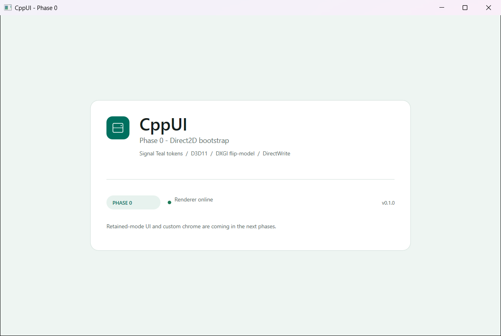

# PHASE 0 — bootstrap

> Статус: завершена 14.11.2026.
> Связанные документы: [PLAN.md](../PLAN.md), [ARCHITECTURE.md](ARCHITECTURE.md), [DESIGN_SYSTEM.md](DESIGN_SYSTEM.md), [QUALITY.md](QUALITY.md).



## Что закрыто

- Git-репозиторий и структура проекта.
- CMake-каркас, Debug/Release пресеты, `/W4 /permissive- /WX`, C++20.
- Статическая библиотека `cppui`.
- Публичные токены Signal Teal (`include/cppui/theme/tokens.hpp`).
- Первое Win32-окно с D3D11 → DXGI flip-model → Direct2D/DirectWrite.
- WARP fallback, resize, базовая Per-Monitor DPI обработка.
- Smoke test токенов и CTest.
- CI workflow для Windows/MSVC.
- Скриншот реального окна и инструкции запуска.

## Окружение

| Компонент | Версия |
|---|---|
| Visual Studio | Community 2026 18.11.2 |
| MSVC | 19.51.36260 x64 |
| Windows SDK | 10.0.26100.0 |
| CMake | 4.3.1-msvc1 |
| Ninja | 1.13.2 |
| Git | установлен |

Visual Studio с C++ workload уже присутствовала; отдельная установка не потребовалась.

## Структура

```text
CMakeLists.txt
CMakePresets.json
include/cppui/theme/tokens.hpp
src/theme/theme.cpp
src/render/d2d/d2d_renderer.hpp
src/render/d2d/d2d_renderer.cpp
samples/bootstrap/main.cpp
tests/theme_tests.cpp
tools/build.ps1
.github/workflows/ci.yml
```

## Сборка

Рекомендуемая локальная команда:

```powershell
.\tools\build.ps1 -Test
```

Скрипт сам находит Visual Studio, CMake и Ninja через `vswhere`, поднимает окружение и собирает presets. По умолчанию используется Visual Studio 2026 generator: это надёжнее на русской локали MSVC, где CMake 4.3 + Ninja могут неправильно разбирать локализованный `/showIncludes`.

Эквивалент вручную:

```powershell
cmake --preset windows-vs2026-debug
cmake --build --preset windows-vs2026-debug
ctest --preset windows-vs2026-debug
```

Для Visual Studio 2022:

```powershell
.\tools\build.ps1 -Preset windows-vs2022-debug -Test
```

Для CI/английской локали остаётся Ninja-путь:

```powershell
cmake --preset windows-msvc-debug
cmake --build --preset windows-msvc-debug
ctest --preset windows-msvc-debug
```

Бинарник:

```text
out/build/windows-vs2026-debug/Debug/cppui-bootstrap.exe
```

## Проверено

- Debug: собрано, CTest `1/1` passed.
- Release: собрано, CTest `1/1` passed.
- Окно открывается, D2D-сцена видна, стандартный Win32 title bar.
- Resize окна не роняет процесс.
- Закрытие окна завершает процесс.
- WARP fallback реализован; сцена отрисована. Выбор hardware/WARP пока не логируется.

## Ограничения

- Phase 0 использует стандартную рамку Windows. Кастомный chrome — Phase 2.
- Retained-mode дерева виджетов, `Form`, `Button` и переключения темы ещё нет.
- Рендерер использует светлые токены; тёмные токены уже есть, но runtime-переключение появится позже.
- Полноценный device-loss recovery (с пересозданием D3D device) не закрыт; сейчас обрабатывается `D2DERR_RECREATE_TARGET` на уровне target.
- Нет Mica/acrylic, UIA, упаковки и установщика.
- CI workflow добавлен, но удалённый GitHub Actions ещё не запускался.
- Локальный Ninja-путь на русской локали MSVC требует Visual Studio generator либо исправления `/showIncludes`-префикса; CI использует английскую локаль.

## Следующий шаг

Phase 1: завершить render-цикл (device loss, idle/present policy), затем перейти к кастомному chrome и retained-mode ядру с кнопкой и темами.
