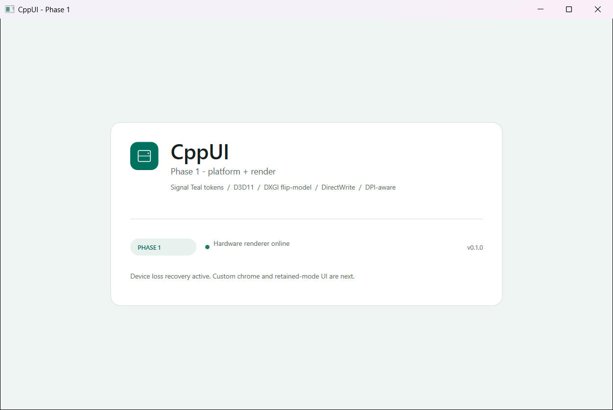

# PHASE 1 — platform + render

> Статус: завершена 14.11.2026.
> Связанные документы: [PLAN.md](../PLAN.md), [PHASE0.md](PHASE0.md), [ARCHITECTURE.md](ARCHITECTURE.md), [QUALITY.md](QUALITY.md).



## Что добавлено

- `Win32Window` вынесен в отдельный слой `src/platform/win32/`: создание окна, message loop, callbacks `paint` / `resize` / `dpi_changed` / `key_down`, минимальный размер в DIP, центрирование.
- Рендерер переведён на Phase 1-поведение: D3D11 → DXGI flip-model → Direct2D/DirectWrite, hardware-адаптер или WARP.
- Полное восстановление устройства: `DEVICE_REMOVED` / `DEVICE_RESET` / `DEVICE_HUNG` пересоздают D3D device, swap chain, D2D device context, bitmap target, brushes и text formats.
- Восстановление target для `D2DERR_RECREATE_TARGET` без полного пересоздания устройства.
- Восстановление после ошибки `ResizeBuffers` с сохранением нового размера.
- Отрисовка только по invalidation, без busy-loop. `Present(1, 0)` остаётся в UI-потоке.
- Статус backend в окне: `Hardware renderer online` или `WARP renderer online`.
- `F5` вручную пересоздаёт устройство; `CPPUI_FORCE_WARP=1` запускает WARP-путь.
- Render smoke test `--self-test`:
  - создаёт скрытое окно;
  - инициализирует renderer;
  - рисует кадр;
  - делает resize;
  - рисует ещё кадр;
  - пересоздаёт device;
  - рисует финальный кадр.

## Проверки

| Проверка | Результат |
|---|---|
| Debug build | OK |
| Release build | OK |
| CTest Debug | 2/2 passed |
| CTest Release | 2/2 passed |
| `cppui.render_smoke` | passed |
| WARP через `CPPUI_FORCE_WARP=1` | exit 0 |
| Idle CPU, 8 секунд | 0.000 s CPU, 0.000% |
| Resize stress (5 размеров) | process responsive |
| F5 device recreation в живом окне | окно продолжило работу |
| Hardware backend | `Hardware renderer online` |

Idle CPU измерялся через `TotalProcessorTime` процесса за 8 секунд без ввода. Это грубая, но достаточная проверка отсутствия непрерывного render loop.

## Сборка и запуск

```powershell
.\tools\build.ps1 -Test
.\out\build\windows-vs2026-debug\Debug\cppui-bootstrap.exe
```

Smoke test отдельно:

```powershell
.\out\build\windows-vs2026-debug\Debug\cppui-bootstrap.exe --self-test
```

WARP:

```powershell
$env:CPPUI_FORCE_WARP = '1'
.\out\build\windows-vs2026-debug\Debug\cppui-bootstrap.exe --self-test
```

## Ограничения

- Окно всё ещё использует стандартную рамку Windows; кастомный chrome — Phase 2.
- Retained-mode дерева, `Form` и `Button` пока нет.
- Полный device-loss recovery проверен через принудительное пересоздание и F5, но не через реальный TDR/`DEVICE_REMOVED` от драйвера.
- Flicker при интерактивном resize не измерялся покадрово; проверено, что resize не роняет процесс и не оставляет пустой target. `WM_ERASEBKGND` отключён, чтобы не было GDI-вспышек.
- Состояние UI пока отсутствует, поэтому recovery не проверяет сохранность документа/выделения.
- Один UI-поток; render thread не вводился.
- Mica/acrylic, UIA, упаковка и установщик не входят в Phase 1.

## Следующий шаг

Phase 2: кастомный chrome (`WM_NCCALCSIZE`, `WM_NCHITTEST`, drag, системные кнопки, Snap Layouts, DWM corners), затем retained-mode ядро с `Form` и `Button`.
