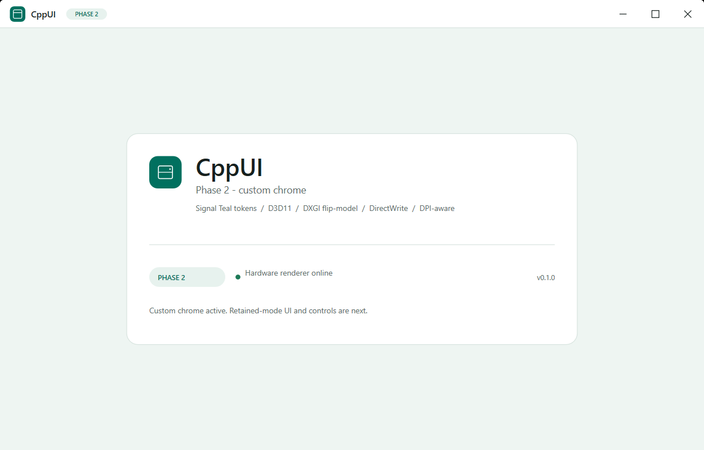

# PHASE 2 — custom chrome

> Статус: завершена 14.11.2026.
> Связанные документы: [PLAN.md](../PLAN.md), [PHASE1.md](PHASE1.md), [ARCHITECTURE.md](ARCHITECTURE.md), [DESIGN_SYSTEM.md](DESIGN_SYSTEM.md).

## Что добавлено

- Кастомный title bar высотой **40 DIP**; приложение рисует его через Direct2D.
- `WM_NCCALCSIZE` убирает стандартный non-client; при maximized клиентская область вписывается в рабочую область монитора с учётом DPI.
- `WM_NCHITTEST` возвращает:
  - `HTCAPTION` для title bar;
  - `HTMINBUTTON`, `HTMAXBUTTON`, `HTCLOSE` для системных кнопок;
  - `HTLEFT`/`HTRIGHT`/`HTTOP`/`HTBOTTOM` и углы для resize.
- Кнопки **minimize / maximize-restore / close**:
  - hover и pressed-состояния;
  - close hover — красный фон и белый крест;
  - restore-глиф после maximize.
- Кнопки не вызывают `SetCapture`: иначе mouse-up приходит клиентским `WM_LBUTTONUP` и действие теряется. Завершение идёт по `WM_NCLBUTTONUP` с fallback на `WM_LBUTTONUP`.
- Активное/неактивное состояние title bar.
- Drag и double-click по title bar делегируются `DefWindowProc`; resize — через стандартные non-client коды.
- `HTMAXBUTTON` оставляет системный механизм Snap Layouts рабочим.
- DWM: `DWMWA_WINDOW_CORNER_PREFERENCE = DWMWCP_ROUND`, frame extension для тени.
- Кнопка закрытия, minimize и maximize протестированы через реальный message path.

## Геометрия

| Параметр | Значение |
|---|---:|
| Title bar | 40 DIP |
| Системная кнопка | 46 × 40 DIP |
| Resize border | 7 DIP |
| Окно | 1000 × 640 DIP |
| Минимум | 720 × 480 DIP |
| Скриншот | 1250 × 800 px при 125% |

## Проверено

| Проверка | Результат |
|---|---|
| Debug/Release build | OK |
| CTest | 2/2 passed |
| Hit test title bar | `HTCAPTION` |
| Hit test min/max/close | `8 / 9 / 20` (`HTMINBUTTON` / `HTMAXBUTTON` / `HTCLOSE`) |
| Hit test content / border | `HTCLIENT` / `HTLEFT` |
| Maximize на 125% | outer 1938 × 1158, work 1920 × 1140 |
| Max client | 1920 × 1140 после NCCALCSIZE-inset |
| Restore | 1250 × 800, исходная позиция |
| Minimize/restore | OK |
| Real mouse minimize | minimized |
| Real mouse maximize/restore | maximized / restored to 1250 × 800 |
| Real mouse close | process exited |
| Close hover | красный фон, белый глиф |
| DWM corner preference | `DWMWCP_ROUND` (value 2) |
| F5 device recreation | OK |

[Close hover](images/phase2-close-hover.png) · [Maximized state](images/phase2-maximized.png)

## Ограничения

- Snap Layouts проверены на уровне `HTMAXBUTTON`; сам flyout визуально не снимался.
- Drag, double-click maximize и resize-border протестированы по коду/HT-кодам, но не автоматизированным drag-тестом.
- DPI-матрица: проверено только 125%; 100/150/200% требуют отдельного прогона.
- DWM rounded corners/shadow не видны на `PrintWindow`-снимке; live-проверка остаётся ручной.
- В title bar пока только min/max/close. Дополнительные действия (theme/settings) и статус-бар — следующие итерации.
- Нет UIA/accessibility для кастомных кнопок.
- Тема только светлая; runtime-переключение появится позже.
- Badge `PHASE 2` — демонстрационный, не финальный брендинг.

## Следующий шаг

Phase 3: retained-mode ядро, `Widget`/layout, `Button` и переключение Light/Dark/System.
