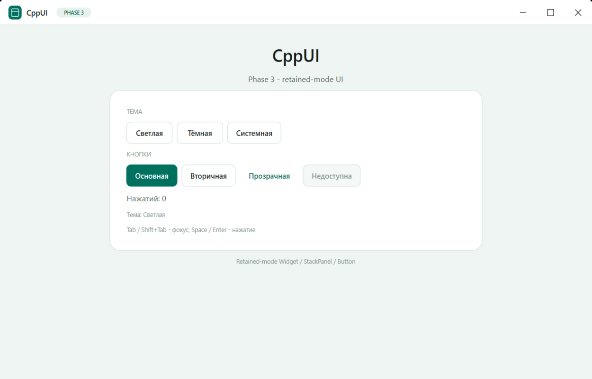

# PHASE 3 — retained-mode core, Button, themes

> Статус: завершена 14.11.2026.
> Связанные документы: [PLAN.md](../PLAN.md), [PHASE2.md](PHASE2.md), [ARCHITECTURE.md](ARCHITECTURE.md), [DESIGN_SYSTEM.md](DESIGN_SYSTEM.md).



Тёмная тема: [phase3-dark.png](images/phase3-dark.png)

## Что добавлено

- Базовые типы: `Point`, `Size`, `Rect`, `Insets`.
- `Painter` — абстрактный контракт отрисовки и измерения текста.
- `Widget` — retained-mode база: `measure → arrange → paint`, hit testing, children, focus/hover/pressed.
- Контейнеры:
  - `StackPanel` — vertical/horizontal, spacing, padding, cross alignment;
  - `CardPanel` — surface/border/radius/content.
- Контролы:
  - `Label`;
  - `Button` — primary/secondary/ghost, disabled, hover/pressed/focus, mouse и keyboard activation.
- `UiHost`:
  - hit testing и hover;
  - click activation;
  - focus по клику и `Tab`/`Shift+Tab`;
  - `Space`/`Enter` для focused Button;
  - mouse leave.
- `ThemeMode::{light, dark, system}`:
  - системная тема через `AppsUseLightTheme`;
  - реакция на `WM_SETTINGCHANGE` / `WM_THEMECHANGED`;
  - `D2DRenderer::SetTheme` без пересоздания device.
- `D2DRenderer` реализует `Painter`:
  - измерение текста через DirectWrite;
  - 5 UI text roles;
  - кеш brushes по цвету;
  - painting дерева widgets поверх кастомного chrome.

## Файлы

```text
include/cppui/geometry.hpp
include/cppui/theme/mode.hpp
include/cppui/ui/painter.hpp
include/cppui/ui/widget.hpp
include/cppui/ui/widgets.hpp
include/cppui/ui/host.hpp
src/theme/mode.cpp
src/ui/widget.cpp
src/ui/widgets.cpp
src/ui/host.cpp
tests/ui_tests.cpp
```

## Проверено

| Проверка | Результат |
|---|---|
| Debug build | OK |
| Release build | OK |
| CTest Debug | 3/3 passed |
| CTest Release | 3/3 passed |
| `cppui.ui` | click, focus, Space, disabled, hit testing |
| Light theme | OK |
| Dark theme | OK |
| System theme | OK (определяется как тёмная на текущей машине) |
| Primary button click | счётчик увеличивается |
| Disabled button | не получает hit/focus/click |
| Focus ring | отображается на выбранной теме/кнопке |
| 125% DPI | координаты мыши и layout согласованы |
| F5 device recreation | UI продолжает рисоваться |

## Реализованные решения

- Layout считается в DIP; координаты мыши переводятся из физических пикселей через сохранённый DPI demo.
- `UiHost` не использует Win32 mouse capture: click завершается на `mouse_up`, если hit не изменился.
- `Button` активируется и мышью, и клавиатурой; disabled исключён из focus order и hit testing.
- `SetTheme` меняет brushes, не пересоздавая D3D/D2D device.
- Системная тема перечитывается при изменении настроек Windows.

## Ограничения

- Пока только `StackPanel`, `CardPanel`, `Label`, `Button`.
- `Form`, status bar, дополнительные titlebar actions и полный gallery-preview — Phase 4.
- Нет UIA/accessibility, high contrast, анимаций и dirty-region rendering: перерисовывается весь клиент.
- Текст не переносится; поддержка wrapping/multiline появится с TextEdit/MemoEdit.
- Проверено на 125% DPI; 100/150/200% требуют отдельного прогона.
- Публичный API widgets пока не стабилизирован.

## Следующий шаг

Phase 4: `Form` и demo-preview — titlebar actions, content host, status bar, набор кнопок и переключение Light/Dark/System в одном экране.
