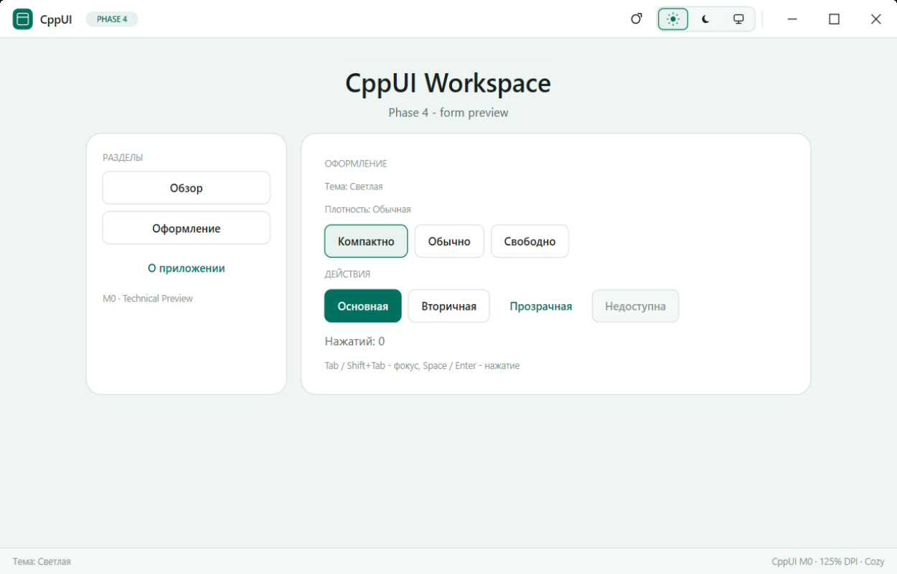

# PHASE 4 — Form preview, StatusBar, titlebar action

> Статус: завершена 14.11.2026.
> Связанные документы: [PLAN.md](../PLAN.md), [PHASE3.md](PHASE3.md), [ROADMAP.md](ROADMAP.md), [ARCHITECTURE.md](ARCHITECTURE.md).



Тёмная тема: [phase4-dark.png](images/phase4-dark.png). Компактный режим:
[phase4-compact.png](images/phase4-compact.png).

## Что добавлено

- `FormPanel` — контейнер формы: content растягивается, `StatusBar` закреплён снизу.
- `StatusBar`:
  - левая и правая текстовые зоны;
  - theme-aware surface и верхняя граница;
  - высота зависит от `DensityMode` (24 / 28 / 34 DIP).
- Preview-экран:
  - sidebar «Разделы» с кнопками «Обзор», «Оформление», «О приложении»;
  - основная карточка с theme/density-состояниями, S/M/L и действиями;
  - счётчик нажатий и строка статуса.
- Минимальный размер окна увеличен до 900×580 DIP, чтобы двухколоночный preview
  не обрезался.
- Дополнительное действие в titlebar: сброс счётчика. Иконка слева от
  переключателя темы, hover/pressed, событие `chrome_action`.
- Все действия обновляют status bar, включая тему, density, счётчик и навигацию.
- Исправлена синхронизация render target с клиентской областью: `LayoutUi` проверяет
  размер target. Без этого после density-перестроения target оставался 986×602 DIP
  при клиенте 1000×640 DIP — нижняя часть UI обрезалась, а координаты клика
  расходились с отрисовкой.

## Файлы

```text
include/cppui/ui/form.hpp
src/ui/form.cpp
samples/bootstrap/main.cpp
src/platform/win32/win32_window.cpp
src/render/d2d/d2d_renderer.cpp
tests/ui_tests.cpp
```

## Проверено

| Проверка | Результат |
|---|---|
| Debug build | OK |
| Release build | OK |
| CTest Debug | 3/3 passed |
| CTest Release | 3/3 passed |
| `cppui.ui` | FormPanel/StatusBar layout, content click, density height |
| Form preview | sidebar, main card, status bar |
| Primary click | счётчик и status bar обновляются |
| Titlebar reset | сбрасывает счётчик и пишет статус |
| Theme switch | Light/Dark/System работают |
| Density S/M/L | Button и StatusBar перестраиваются вместе |
| Render target sync | UI не обрезается после density-перестроения |
| 125% DPI | layout, hit testing и отрисовка согласованы |

## Ограничения

- `FormPanel` — layout-контейнер, а не полный публичный top-level `Form` API;
  Win32-окно по-прежнему создаётся в demo.
- Density применяется к `Button` и `StatusBar`; `Label`, `CardPanel`, `StackPanel`
  и будущие data-контролы подключаются в v0.1.
- В titlebar пока одно дополнительное действие (reset); toolbar/menu/command —
  дальнейшие волны.
- Нет UIA, tooltips для titlebar-иконок, high contrast, анимаций, dirty-region.
- Проверено на 125% DPI; 100/150/200%, multi-monitor, Snap-flyout и performance
  budgets остаются в Phase 5 / M0 hardening.

## Следующий шаг

Phase 5 — hardening M0: resize/DPI matrix, visual regression, performance budgets,
полный Form API и проверка оставшихся критериев Technical Preview.
