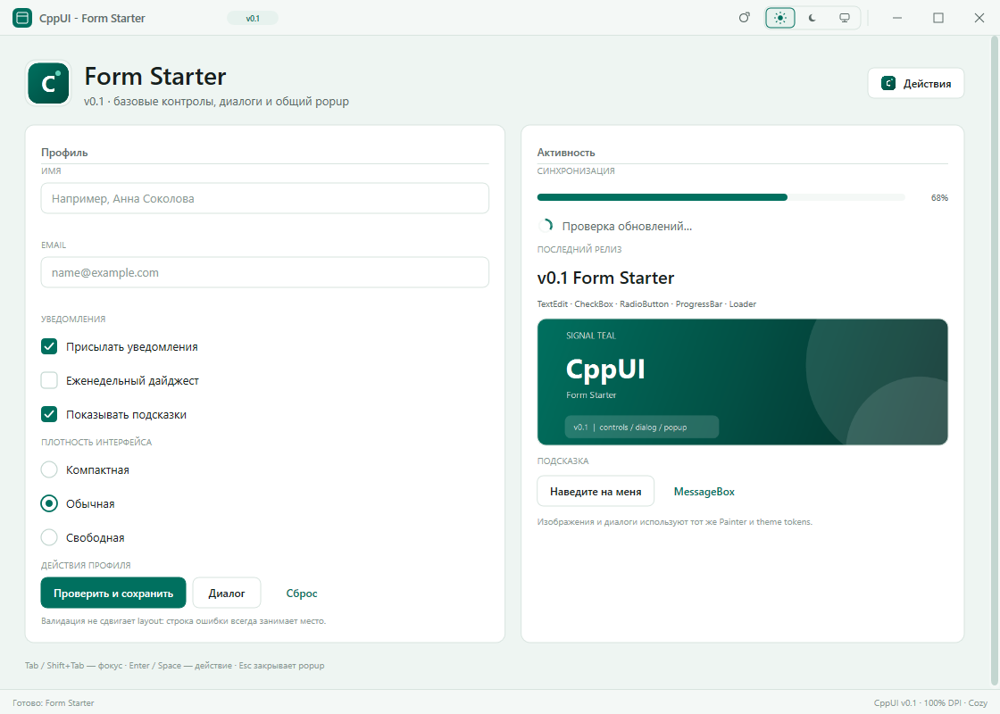
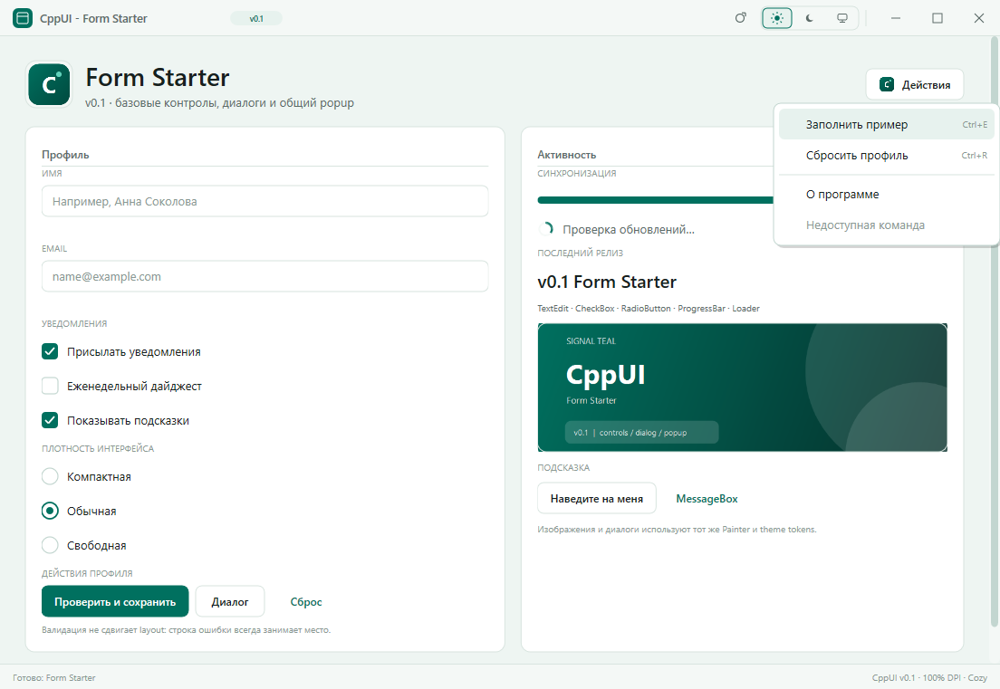
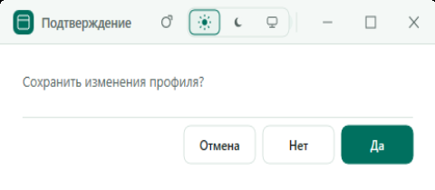
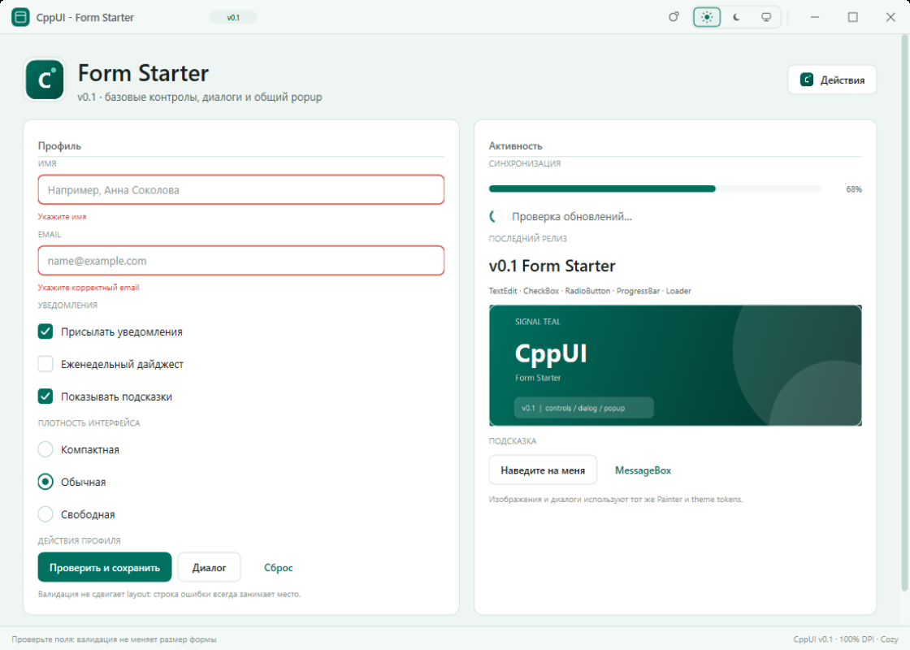
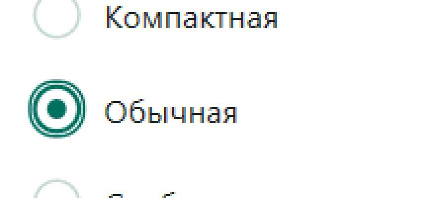

# v0.1 — Form Starter

> Статус: **реализовано и принято локально** · 15.11.2026.
> Следующая волна — v0.2 Input & Selection. Каталог API — [CONTROLS.md](CONTROLS.md).

## 1. Что вошло в волну

v0.1 закрывает минимальный набор, из которого собирается настоящая небольшая форма:

- контейнеры `Panel`, `GroupPanel`, `StackPanel`, `GridPanel`;
- `ScrollViewer` и `ScrollBar`;
- `TextEdit` с выделением, буфером обмена, undo/redo, max length, read-only и IME;
- `CheckBox` (включая indeterminate) и `RadioButton` + `RadioGroup`;
- `ProgressBar`, `Loader`, `ProgressRing`, `BusyOverlay`;
- общий `PopupHost`, `PopupMenu` и `ToolTip`;
- модальные `Dialog` и `MessageBox` с тем же кастомным chrome;
- `Image`/`PictureBox` через WIC и иконки в `Button`;
- базовую валидацию через `Widget::set_validation_error`;
- `Command` как общий источник text/enabled/checked/shortcut;
- единый `DensityMode` для всех контролов волны.

Тёмная тема: [v01-form-dark.png](images/v01-form-dark.png). Компактная плотность:
[v01-form-compact.png](images/v01-form-compact.png). Popup-меню:
[v01-form-popup.png](images/v01-form-popup.png).

## 2. Демо

`cppui-form-starter` собирается по тому же контракту, что и пользовательское приложение:
публичный `Form`, без доступа к внутреннему `UiHost` или `D2DRenderer`.

Что можно проверить руками:

1. `Имя`/`Email` — ввод с клавиатуры и IME, выделение, clipboard, undo/redo.
2. `Проверить и сохранить` — inline-ошибки под полями не сдвигают layout.
3. `Действия` — popup-меню с shortcut-подписями, disabled item и click-outside dismiss.
4. `Диалог` — модальный `Dialog` с текстовым полем и `DialogResult`.
5. `MessageBox` — подтверждение Yes / No / Cancel с owner-disable и возвратом фокуса.
6. Плотность `Компактная / Обычная / Свободная` меняет все контролы через `Form::SetDensityMode`.
7. Tooltip появляется при наведении через 600 мс; он пассивный и не перехватывает мышь.
8. `Loader` анимируется только пока видим; в покое таймер останавливается.

Focus-ring `RadioButton` у левой границы `GroupPanel`:

## 3. Архитектурные решения волны

### 3.1 PopupHost вместо второго HWND

`PopupHost` — корневой виджет формы. Он хранит контент, модальный popup и пассивный tooltip:

- popup позиционируется в DIP и зажимается в клиентскую область;
- клик вне popup закрывает его;
- Esc и Enter обрабатывает `PopupMenu`;
- Tab замыкается внутри popup (`focus_trap`), фон не получает фокус;
- tooltip не участвует в hit-testing;
- закрытый popup переезжает в `retired_`, поэтому callback пункта меню может безопасно
  закрыть popup, не разрушая объект под собственным стеком.

### 3.2 Dialog как отдельное окно

`Dialog` использует тот же `Win32Window`, `D2DRenderer`, `UiHost` и те же токены:

- собственный `DialogSurface` с контентом и правым рядом кнопок;
- modal loop изолирован от `Form`;
- owner отключается на время `ShowModal`, после закрытия фокус возвращается;
- X и Esc возвращают `cancel`, кнопки — свой `DialogResult`;
- у диалога нет переключателя темы и action-кнопки — только системные caption-кнопки;
- тема и DPI наследуются от owner;
- `MessageBox` строится поверх `Dialog` и принимает локализуемые подписи кнопок.

### 3.3 TextEdit

- UTF-16 буфер, caret/anchor, Shift-выделение, Ctrl+A/C/X/V/Z/Y.
- Undo/redo — снимки текста и выделения, лимит 100 шагов.
- Горизонтальный сдвиг текста удерживает caret в видимой области.
- IME: результат композиции приходит через `WM_IME_COMPOSITION` (`GCS_RESULTSTR`);
  `Win32Window` ставит composition/candidate window у caret-прямоугольника.
- Валидация меняет рамку и доступна через `has_validation_error`; текст ошибки рисует
  приложение рядом с полем.

### 3.4 Image и Button icon

`Image` — immutable premultiplied BGRA; загрузка PNG/JPEG идёт через WIC в platform-слое,
а `Painter::draw_image` создаёт D2D bitmap. `PictureBox` поддерживает `contain`, `cover`,
`stretch`, placeholder и скругление. `Button` принимает `std::shared_ptr<Image>` и рисует
иконку слева от текста.

## 4. Критерии выхода

- [x] Демо с формой, полем ввода, чекбоксами, радио-группой, статус-баром, диалогом и popup-меню.
- [x] TextEdit: selection, clipboard, undo/redo, IME result string, caret placement.
- [x] Валидация отображается и не ломает layout.
- [x] Keyboard navigation: Tab/Shift+Tab, Enter/Space, стрелки в RadioGroup, стрелки/Home/End в PopupMenu, Esc.
- [x] Scroll работает для панелей; TextEdit прокручивает caret по горизонтали; API не мешает virtualization.
- [x] Документация на каждый публичный контрол — [CONTROLS.md](CONTROLS.md).
- [x] `DensityMode` применяется ко всем контролам волны.
- [x] Unit/integration/visual-тесты: **13/13 в Debug и Release**; визуальные baselines Light/Dark/Compact/Popup, включая WARP.
- [x] MessageBox/Dialog integration test: owner-disable, default button, X → cancel.
- [x] ToolTip проверен в живом окне; popup — click-outside dismiss и keyboard.

## 5. Тесты

| Тест | Что покрывает |
|---|---|
| `cppui.v01` | TextEdit, CheckBox, RadioGroup, GridPanel star/auto, ScrollViewer, Command, Label wrap, ProgressBar/Loader/BusyOverlay, Image/PictureBox, PopupMenu/PopupHost/ToolTip |
| `cppui.dialog` | Modal Dialog result, default-button Enter, mouse click on button center, owner re-enable, MessageBox close → cancel |
| `cppui.visual_v01` | Form Starter Light/Dark/Compact/Popup, WIC PNG, допуск 8/255 и 2% |
| `cppui.visual_v01_warp` | тот же набор на WARP (`CPPUI_FORCE_WARP=1`) |
| accessibility | name/role/value у Label, Button, TextEdit, CheckBox, RadioButton, ProgressBar |
| `cppui.form` | публичный Form API и message loop |
| `cppui.ui` | Widget layout/hit/focus/Button/FormPanel |
| `cppui.theme`, `cppui.render_smoke`, `cppui.benchmark`, `cppui.dpi`, `cppui.chrome`, `cppui.dpi_awareness` | регрессии предыдущих волн |

## 5.1 Исправления после визуального ревью

- Form Starter объявляет **Per-Monitor V2** до создания окна. Раньше процесс был
  DPI-unaware: Windows растягивал кадр 96→125%, из-за чего текст в диалоге выглядел
  сплющенным, а координаты hover/click не совпадали с видимыми кнопками.
- `Win32Window` теперь возвращает 0 на **оба** вызова `WM_NCCALCSIZE` (`TRUE` и
  `FALSE`). Раньше первый вызов оставлял стандартный caption, клиентская область
  диалога была на ~40 px меньше, и низкие хит-зоны кнопок не совпадали с paint.
- В диалоге убраны theme switch и action-кнопка; caption содержит только системные
  min/max/close. Кнопки и текст больше не конкурируют с переключателем темы.
- `GroupPanel` расширяет clip на 6 DIP, поэтому не срезаются ни stroke в 1–1.5 px,
  ни внешний focus-ring `CheckBox`/`RadioButton`, который выходит за bounds на ~3 DIP.
- `PictureBox` использует `push_rounded_clip`: PNG больше не выходит за скруглённый
  угол баннера.
- Primary `Button` рисует focus-ring цветом `on_accent`, а не accent-на-accent.
- Анимация `Loader` использует `timeBeginPeriod(1)` на время жизни таймера; фаза
  считается по фактическому времени, а не по числу кадров.
- D2D-изображения кешируются по стабильному `Image::id()`. До этого фон и иконка
  создавали новый `ID2D1Bitmap` **на каждом кадре** анимации, что давало редкие
  паузы загрузки GPU. 12-секундная проверка после кеша не нашла кадровых разрывов
  больше 100 мс.
- `cppui.dialog` проверяет mouse-клик по центру кнопки, а не только Enter.

## 6. Ограничения v0.1

Это сознательно не входит в волну, а не скрытый баг:

- `Dialog` пока только модальный; non-modal owner-окно и диалог без блокировки — v0.2.
- IME: поддержан финальный текст и позиционирование candidate window; собственная отрисовка
  inline composition preview не делалась, проверка с CJK-IME на живой машине не проводилась.
- `TextEdit` однострочный; `MemoEdit`, пароль, поиск, маска — v0.2.
- Нет Shift+click, double/triple-click selection и выделения за пределами окна.
- `Label` переносит по словам, но не поддерживает ellipsis/mnemonics.
- `PopupMenu` без вложенных подменю и скролла; для длинных меню нужен scroll-контейнер позже.
- `ToolTip` имеет фиксированную задержку 600 мс и позиционируется у курсора.
- `PictureBox` не грузит SVG; PNG/JPEG через WIC.
- `BusyOverlay` блокирует мышь и фокус, но не является отдельным модальным окном.
- UIA, high contrast и reduced motion остаются на v1.0.
- `GridPanel` трактует weight `0` как auto-sized колонку; сложные span-комбинации
  star/auto раскладываются консервативно.

## 7. Следующая волна

v0.2 Input & Selection:

- `MemoEdit`, `ComboBox`, `CheckedComboBox`, `ListBox`, `ListView`, `SpinEdit`;
- `DropDownButton`, `SplitButton`, `ToggleSwitch`, `Slider`;
- `DateEdit`/`Calendar`, `TabControl`, `SplitContainer`;
- file/folder dialogs;
- начало UIA для ключевых контролов.
